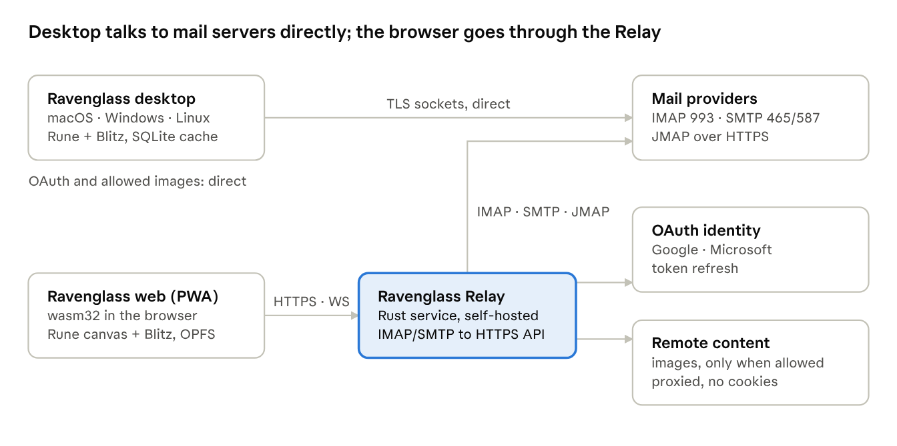
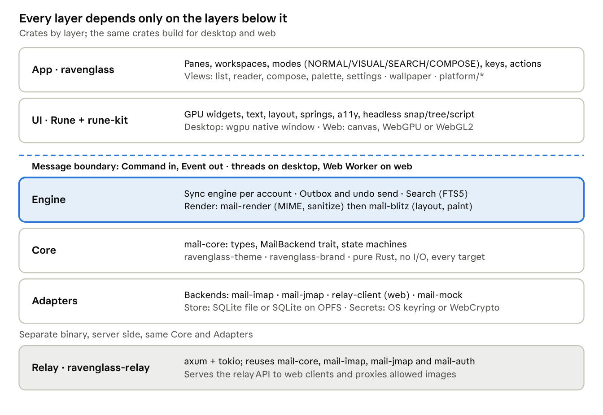
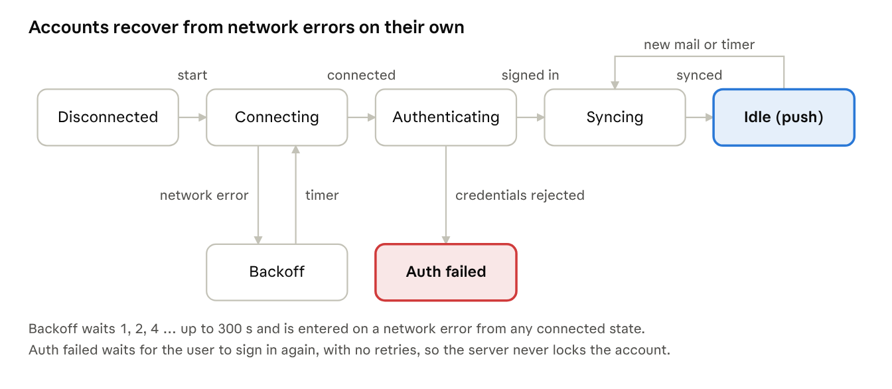
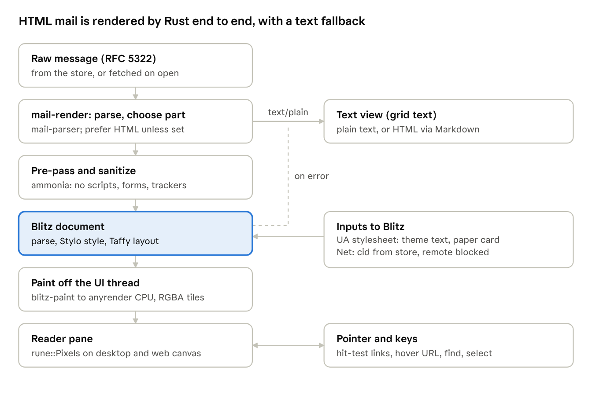
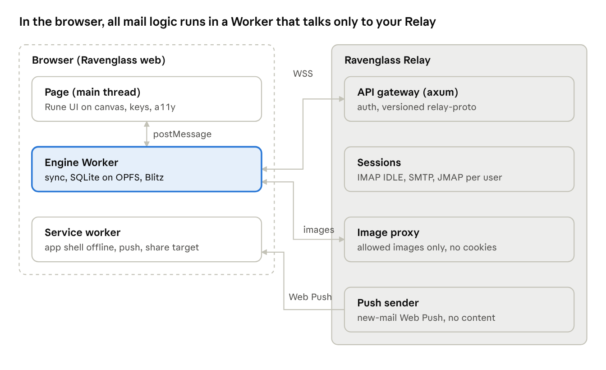
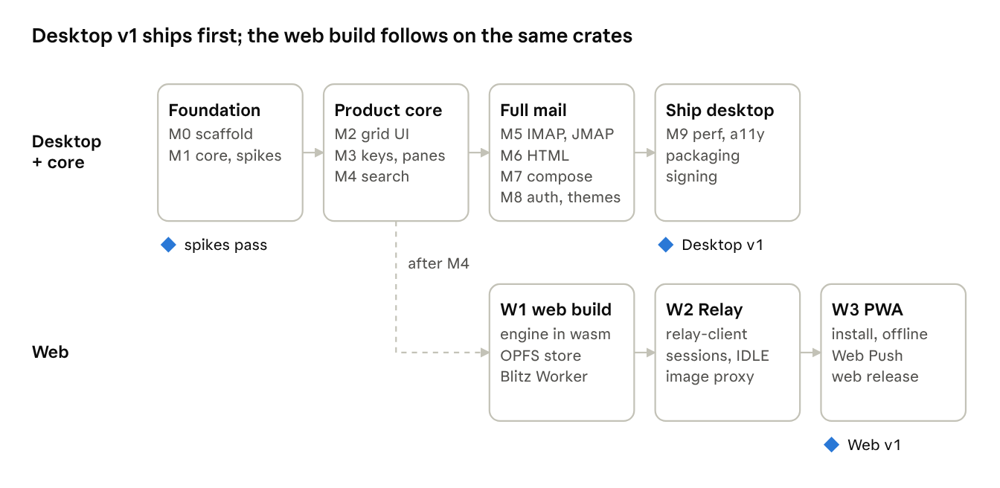

# Ravenglass — End-to-End Software Architecture

Nov 22, 2026 · Jason

> Live, editable version: https://claude.ai/artifact/X9pZNoVeBpVkYeh3zZMs8J

## 1. Summary

Ravenglass is one Rust codebase that ships as a native desktop mail client (macOS, Windows, Linux) and as a web app compiled to WebAssembly, with HTML email rendered by Rust code (Blitz) on both. The UI is built on the Rune GPU framework as a keyboard-first character grid. The web build reaches mail servers through a small Rust service, the **Ravenglass Relay**, because browsers cannot open IMAP or SMTP sockets.

### Goals

| # | Goal | Measure |
| --- | --- | --- |
| G1 | One Rust codebase for every target | ≥ 90% of crates shared between desktop and web; platform code only in `platform/*` and `relay` |
| G2 | HTML email rendered by Rust, not a webview | Blitz renders the 30-email corpus with no panics on all targets |
| G3 | Web-native | Installable PWA, works offline for cached mail, deep links per message, no plugin or extension |
| G4 | Keyboard-first speed | Every action reachable from keys; 1 key for triage actions |
| G5 | Private by default | Remote content blocked until allowed; no telemetry; credentials never in plain text at rest |
| G6 | Personal | Themes, keys and layout are user data, editable and portable |

### Non-goals (v1)

- A full web browser inside mail: no JavaScript in email, ever.
- Calendar, contacts management and tasks beyond what mail needs (address completion, `.ics` shown as an attachment).
- S/MIME and PGP (planned later, section 16).
- Mobile apps (iOS and Android); the web build on a phone is best-effort.
- A hosted multi-tenant mail service: the Relay is self-hostable software, not a product we operate.

### Decided constraints

| Decision | Choice | Why |
| --- | --- | --- |
| Language | Rust only (no C/C++/Objective-C engines, no system webviews) | One toolchain, memory safety, one codebase for wasm and native |
| UI framework | Rune (anomalyco/rune), pinned `dev` rev `0ca07561` | GPU-drawn widgets on desktop and web, headless test tooling |
| HTML engine | Blitz (Stylo + Taffy + Parley), no JavaScript | Pure Rust, shares Taffy and Parley with Rune, no JS attack surface |
| Look | Character grid modelled on the unstablebuild/rune IDE; Night and Frost themes | Brand and UX decided in the design canvas |
| Name and icon | Ravenglass; icon D · Braille (dark + light) | Decided 2026-11-13 |

Status: architecture proposal. The pure crates `mail-core`, `mail-mock`, `ravenglass-theme` and `ravenglass-brand` exist with 18 passing tests; the app and everything else below is design.

## 2. System context and deployment targets

Ravenglass ships as two clients built from the same crates: a native desktop app that opens TLS sockets to mail servers itself, and a browser app that cannot, so it talks to the Ravenglass Relay over HTTPS and WebSocket. The Relay is the only server-side component and holds no mailbox data at rest beyond short-lived session state.



The desktop app needs no Relay; the web app needs one Relay per user, household or organisation, run by whoever hosts the web app.

| Target | Build | Runs | Reaches mail via | Local store | Ships as |
| --- | --- | --- | --- | --- | --- |
| macOS 13+ (Liquid Glass extras on 26+) | `aarch64/x86_64-apple-darwin` | Native window, Metal through wgpu | Direct IMAP/SMTP/JMAP | SQLite file | Signed, notarized `.app` / `.dmg` |
| Windows 10/11 | `x86_64/aarch64-pc-windows-msvc` | Native window, DX12/Vulkan through wgpu | Direct | SQLite file | MSIX or MSI |
| Linux (X11, Wayland) | `x86_64/aarch64-unknown-linux-gnu` | Native window, Vulkan/GL through wgpu | Direct | SQLite file | AppImage, `.deb`, Flatpak |
| Web (Chromium, Firefox, Safari current) | `wasm32-unknown-unknown` | Rune canvas, WebGPU with WebGL2 fallback | Relay (HTTPS + WebSocket) | SQLite on OPFS, IndexedDB fallback | Static files + service worker (PWA) |
| Relay | `x86_64/aarch64-unknown-linux-musl` | Headless Rust server (axum + tokio) | Direct IMAP/SMTP/JMAP | Session state only (Redis or in-memory) | OCI container, single static binary |

## 3. Architecture overview

The app is split at one message boundary: the UI sends `Command`s to an engine and renders the `Event`s it gets back, so the same engine runs on desktop threads and inside a browser Web Worker without code changes. Everything below the boundary is plain Rust with no UI dependency; everything platform-specific is an adapter chosen at build time.



### Crate map

| Crate | Layer | Responsibility | Desktop | Web | Relay |
| --- | --- | --- | --- | --- | --- |
| `ravenglass` (app) | App | Views, panes, modes, keys, settings, platform glue | yes | yes | — |
| `ravenglass-engine` | Engine | Command/Event loop; owns backends, store, renderer, outbox | yes (threads) | yes (Worker) | — |
| `mail-render` | Engine | MIME parse (`mail-parser`), part choice, sanitize (`ammonia`), text view | yes | yes | — |
| `mail-blitz` | Engine | Blitz document, net provider, layout, paint to RGBA tiles, hit-testing | yes | yes | — |
| `mail-store` | Adapters | Schema, cache, FTS5 search, migrations | `rusqlite` | `sqlite-wasm-rs` (OPFS) | — |
| `mail-core` | Core | Types, `MailBackend`, state machines | yes | yes | yes |
| `ravenglass-theme` / `-brand` | Core | Themes, roles, contrast; raven geometry and dot field | yes | yes | — |
| `mail-imap` | Adapters | IMAP4rev1/rev2 + SMTP (`async-imap`, `lettre`) | yes | — | yes |
| `mail-jmap` | Adapters | JMAP Core + Mail (RFC 8620/8621) over HTTPS | yes | via Relay | yes |
| `relay-client` | Adapters | `MailBackend` over the Relay API (HTTPS + WebSocket) | — | yes | — |
| `relay-proto` | Core | Relay API types, versioned, serde | — | yes | yes |
| `mail-auth` | Adapters | OAuth2 (PKCE), token refresh, secret storage | keyring | WebCrypto + IndexedDB | yes |
| `mail-mock` | Adapters | Deterministic backend for tests and scenes | tests | tests | tests |
| `ravenglass-relay` | Relay | axum server: sessions, API, IMAP IDLE fan-out, image proxy | — | — | yes |

### Dependency rules

1. A crate depends only on crates in its own layer or below; Core depends on nothing project-specific.
2. Only `ravenglass` depends on Rune. The engine never imports UI types, so it runs headless, in a Worker and in tests.
3. Target differences live behind traits chosen with `cfg(target_arch = "wasm32")` in one module per adapter, never scattered `cfg`s in features.
4. No `std::fs`, `PathBuf` or blocking I/O in shared crates (a Rune rule for wasm), so the store and settings can sit on browser storage.
5. `relay-proto` is the only contract between web client and Relay and is versioned (section 8).

### Runtime and threading

| Concern | Desktop | Web |
| --- | --- | --- |
| UI | Rune main thread; draws only on change | Rune on the page's main thread (Rune runs background work there via `spawn_local`) |
| Engine | Dedicated thread with a tokio runtime; one task per account | Dedicated Web Worker running the engine wasm; one async task per account |
| Store | One writer thread, a pool of readers (WAL) | Inside the Worker (OPFS sync access handles are Worker-only) |
| HTML layout and paint | Worker pool (2–4 threads), tile jobs | A separate render Worker the engine can restart; tiles posted to the page as transferable `ImageBitmap`s |
| Network | `tokio` + `rustls` sockets | `fetch` + `WebSocket` to the Relay |
| Boundary transport | Crossbeam channels; wake the UI with `rune::Tx` | `postMessage` with `bincode` frames; the page wakes Rune on receipt |

## 4. Domain model and the MailBackend abstraction

Every mail source (IMAP, JMAP, the Relay, the test mock) implements one trait, `MailBackend`, over one set of plain types, so the engine, store and UI never branch on protocol. Ids are opaque strings so IMAP UIDs, JMAP ids and mock ids all fit; bodies are fetched lazily, on open.

### Entities

| Entity | Key fields | Notes |
| --- | --- | --- |
| `Account` | id, display name, address, provider kind, auth method, backend kind | One per configured mailbox login |
| `Folder` | id, account, path, role (Inbox, Drafts, Sent, Archive, Trash, Junk, Flagged, Other), unread, total | Gmail labels map to folders with a `label` flag |
| `Envelope` | id, folder, thread, from, to, cc, subject, preview, date, flags, attachments | What the list needs; about 1 KB each |
| `Thread` | id, message ids, participants, latest date | Built from `References`/`In-Reply-To` and JMAP thread ids |
| `RawMessage` | id, RFC 5322 bytes | Cached on open, evicted by size (section 6) |
| `Attachment` | name, MIME type, size, content id | Bytes fetched on demand |
| `Draft` | id, from, recipients, subject, rich body, attachments, reply context | Autosaved locally, appended to Drafts |
| `SyncToken` | opaque | IMAP: UIDVALIDITY + HIGHESTMODSEQ; JMAP: state string |

### The trait

```rust
pub trait MailBackend: Send + Sync {
    fn account(&self) -> &AccountId;
    fn list_folders(&self) -> BoxFut<'_, Result<Vec<Folder>>>;
    fn sync_folder<'a>(&'a self, folder: &'a FolderId, since: &'a SyncToken) -> BoxFut<'a, Result<FolderDelta>>;
    fn fetch_body<'a>(&'a self, msg: &'a MessageId) -> BoxFut<'a, Result<RawMessage>>;
    fn set_flags<'a>(&'a self, msgs: &'a [MessageId], add: Flags, remove: Flags) -> BoxFut<'a, Result<()>>;
    fn move_to<'a>(&'a self, msgs: &'a [MessageId], to: &'a FolderId) -> BoxFut<'a, Result<()>>;
    fn append_draft<'a>(&'a self, raw: &'a [u8]) -> BoxFut<'a, Result<MessageId>>;
    fn send<'a>(&'a self, raw: &'a [u8], from: &'a Address, rcpt: &'a [Address]) -> BoxFut<'a, Result<()>>;
    fn idle<'a>(&'a self, folder: &'a FolderId, events: Sender<IdleEvent>) -> BoxFut<'a, Result<()>>;
}
```

This is the trait in `mail-core` today. Before M5 it gains `search_server` (for mail older than the local cache) and `fetch_part` (a single attachment without the whole message). `BoxFut` keeps it object-safe without `async-trait`, and every future is `Send` except on wasm, where the Worker is single-threaded.

### Backends

| Backend | Used on | Protocols | Push | Notes |
| --- | --- | --- | --- | --- |
| `mail-imap` | Desktop, Relay | IMAP4rev1 + CONDSTORE/QRESYNC, MOVE, IDLE; SMTP submission | IMAP IDLE on Inbox, poll others | Falls back to COPY + EXPUNGE without MOVE |
| `mail-jmap` | Desktop, Relay | JMAP Core + Mail over HTTPS | JMAP EventSource / push | Preferred where offered (e.g. Fastmail) |
| `relay-client` | Web | Relay API over HTTPS + WebSocket | Relay pushes over the WebSocket | Implements the same trait, so the engine is unchanged |
| `mail-mock` | Tests, scenes | none | none | Same seed gives the same data |

### Provider support (v1)

| Provider | Read | Send | Sign-in | Specifics |
| --- | --- | --- | --- | --- |
| Gmail / Google Workspace | IMAP | SMTP | OAuth2 (XOAUTH2) | Labels as folders; the server saves Sent itself, so no APPEND |
| Microsoft 365 / Outlook.com | IMAP | SMTP | OAuth2 (XOAUTH2) | Requires an app registration (client id) |
| iCloud Mail | IMAP | SMTP | App-specific password | — |
| Fastmail | JMAP | JMAP | App password or OAuth | JMAP gives server-side search and push |
| Any IMAP/SMTP host | IMAP | SMTP | Password or app password | Autoconfig via Mozilla ISPDB and SRV records |

Which providers come first is still open (section 16).

## 5. Sync engine and state machines

The engine runs one async task per account and drives every mode, phase and timer through an explicit state machine: one `enum State`, one pure `step(state, event) -> Effects`, with timers delivered as events. The same step functions run on desktop, in the web Worker and in unit tests, and `AccountSync` and `Outbox` already exist with tests in `mail-core`.



### Machines

| Machine | States | Driven by | Effects it emits |
| --- | --- | --- | --- |
| `AccountSync` | Disconnected, Connecting, Authenticating, Syncing{done,total}, Idle, Backoff{attempt,due}, AuthFailed | Start, Connected, Authenticated, FolderSynced, Failed, Timer, IdleWoke | Connect, Authenticate, SyncNext, StartIdle, WakeAt, Notify |
| `Outbox` (per message) | Queued{undo\_until}, Sending{attempt}, Sent, Failed{error,attempt}, Cancelled | Undo, Timer, SendOk, SendErr, Retry | ShowUndo, WakeAt, Send, Notify |
| `ComposeSession` | Editing, SavingDraft, Sending, Closed | Edit, AutosaveTimer, DraftSaved, Send, Discard | AppendDraft, QueueSend |
| `HtmlView` (per open message) | Parsing, LaidOut{width}, Rastering{tiles}, Ready, Failed | Width, Scale, Theme, ImagesAllowed, Find | Layout, Raster, Fallback |
| `ImageLoad` (per message) | Blocked, Allowed, Loading, Loaded, Failed | Allow once, Allow sender, Fetched | Fetch (via proxy on web) |
| `Mode` (UI) | Normal, Visual, Search, Compose, Command | Keys | Actions |

### Sync algorithm

1. On connect, list folders; Inbox first, then folders the user has open, then the rest by recency.
2. Per folder, resume from its `SyncToken`: IMAP uses CONDSTORE/QRESYNC to fetch only changed flags and new UIDs, and checks UIDVALIDITY (a change means a full resync of that folder). JMAP uses `Email/changes` with the stored state string.
3. New mail fetches envelopes and a 200-character preview only. Bodies download on open, plus prefetch of the newest 50 Inbox bodies on unmetered connections.
4. Push: IMAP IDLE on Inbox (re-issued every 25 minutes), polling for other folders every 5 minutes; JMAP push where offered. On the web, the Relay holds the IDLE and pushes changes over the WebSocket.

### Offline actions and conflicts

- Every user action applies to the local store at once (optimistic) and is journaled as a pending operation: flag, move, delete, draft, send.
- The journal replays in order when the account reaches Syncing or Idle. A failed replay rolls the local change back and shows one line in the status bar.
- Conflicts follow the server for flags (newer MODSEQ wins) and moves (a message gone from the server is gone locally). A local draft never overwrites a newer server draft: both are kept and the user picks.
- Undo send holds a message in `Outbox` for 10 seconds by default (configurable 0–30 s). Undo for archive and delete replays the inverse operation.

### Engine API (the message boundary)

| Commands (UI → engine) | Events (engine → UI) |
| --- | --- |
| `OpenAccount`, `SelectFolder`, `LoadRange(folder, range)`, `OpenMessage(id, width, scale)` | `FolderList`, `Envelopes(range)`, `Counts`, `SyncState(account, state)` |
| `SetFlags`, `Move`, `Delete`, `Undo(op)` | `Applied(op)`, `Reverted(op, reason)` |
| `Search(query)`, `SaveDraft`, `Send(draft)`, `CancelSend(id)` | `SearchResults`, `DraftSaved`, `OutboxState(id, state)` |
| `ResizeReader(width)`, `AllowImages(scope)`, `FindInMessage(text)` | `Body(text or tiles)`, `TilesReady`, `LinkHover(url)` |

Commands and events are serde types in `ravenglass-engine::api`, so the same enums cross threads on desktop and `postMessage` on the web.

## 6. Storage, cache and search

One SQLite schema serves every client: a file on desktop, and on the web SQLite compiled to wasm with its database in the Origin Private File System (OPFS), falling back to IndexedDB blocks. [sqlite-wasm-rs](https://docs.rs/crate/sqlite-wasm-rs/0.4.6/source/README.md) provides both: its `sahpool` VFS stores the database in OPFS and its `relaxed-idb` VFS stores it in blocks in IndexedDB. Search is SQLite FTS5 on both.

### Backends per target

| Target | Engine | Location | Concurrency |
| --- | --- | --- | --- |
| Desktop | `rusqlite` (bundled SQLite, FTS5) | OS data dir (`~/Library/Application Support/Ravenglass`, `%APPDATA%\Ravenglass`, `$XDG_DATA_HOME/ravenglass`) | WAL; 1 writer thread, reader pool |
| Web (preferred) | `sqlite-wasm-rs` + OPFS `sahpool` VFS | Origin-private, per site | Single connection inside the engine Worker |
| Web (fallback) | `sqlite-wasm-rs` + `relaxed-idb` VFS | IndexedDB | Same; used where OPFS sync access is missing |
| Relay | none for mail | — | Session state only (section 8) |

### Schema (v1)

| Table | Holds | Key / indexes |
| --- | --- | --- |
| `accounts` | Settings per account (never secrets) | `id` |
| `folders` | Path, role, counts, `sync_token` | `(account, id)` |
| `messages` | Envelope fields, flags, thread id, size, has\_attachments | `(account, id)`; `(folder, date DESC)`; `(thread)` |
| `bodies` | Raw RFC 5322 bytes (zstd-compressed), last opened | `message_id`; evicted by LRU |
| `parts` | Attachment metadata; bytes only when saved or previewed | `(message_id, part_id)` |
| `search` | FTS5 virtual table over from, to, subject, preview, body text | `unicode61` tokenizer, `remove_diacritics 2` |
| `ops_journal` | Pending offline operations (section 5) | `seq` |
| `outbox` | Queued messages and their state | `id` |
| `contacts` | Addresses seen, with use counts, for completion | `email` |
| `image_policy` | Per-sender remote-image allow list | `sender` |
| `meta` | Schema version, migrations applied | — |

Migrations are forward-only SQL files embedded with `include_str!` and run at open, inside a transaction.

### Search

- Query language: free text plus `from:`, `to:`, `subject:`, `has:attachment`, `is:unread`, `is:flagged`, `in:<folder>`, `before:`/`after:` (ISO dates), parsed in `mail-store` into FTS5 `MATCH` plus SQL filters.
- Body text enters the index when a body is fetched (plain part, or text extracted from sanitized HTML), so search covers everything cached.
- Mail outside the cache: the engine falls through to server search (IMAP `SEARCH`, JMAP `Email/query`) and merges results, marking them "server".

### Limits and eviction

| Item | Desktop default | Web default |
| --- | --- | --- |
| Envelopes kept | All | Last 12 months per account (older paged from the server on demand) |
| Bodies cache | 2 GB, LRU | 300 MB, LRU, kept under the browser storage quota |
| Attachments | On demand, not cached unless saved | On demand, never cached |
| HTML raster tiles | In memory, 64 MB | In memory, 32 MB |

On the web the app calls `navigator.storage.persist()` at first sign-in so the browser does not evict the cache under storage pressure, and shows usage in Settings.

### Encryption at rest

- Desktop relies on the OS disk encryption (FileVault, BitLocker, LUKS) by default; an optional database key (SQLCipher-compatible via SQLite3MultipleCiphers) is stored in the OS keyring.
- Web: browser storage is per origin and not encrypted by the app in v1; the session can be locked and the local cache wiped from Settings. Encrypting the OPFS database (`sqlite3mc` feature) with a key derived from a passkey is a later option.

## 7. HTML email rendering

Ravenglass renders HTML email in Rust on every target: sanitize with `ammonia`, lay out and paint with Blitz into RGBA tiles, and show the tiles in the reader pane as a `rune::Pixels` surface. There is no webview and no JavaScript engine anywhere in the pipeline; if Blitz fails on a message, the same message is shown in the text view instead.



Blitz fits because it is Rust end to end and modular: it combines [Stylo for CSS resolution, Taffy for box layout and Parley for text layout](https://lib.rs/crates/blitz-html), and Taffy and Parley are already inside Rune. Its repository includes a [`wasm_hello` example that drives Blitz on the `wasm32-unknown-unknown` target](https://docsearch.algolia.com/mcp/docs/repo/dioxuslabs/blitz), which is the basis for the web build. Its maintainers say they [would not yet recommend building apps with it](https://cdn.jsdelivr.net/gh/dioxuslabs/blitz@main/README.md), so the plan pins a version, spikes it first (M1) and keeps the text fallback permanent.

### Stages

| # | Stage | Crate | What happens |
| --- | --- | --- | --- |
| 1 | Parse | `mail-render` (`mail-parser`) | Decode MIME, charsets and transfer encodings; build the part tree; collect attachments and inline `cid:` parts |
| 2 | Choose part | `mail-render` | `text/html` if present (unless the account prefers plain), else `text/plain`; `multipart/related` keeps its inline images |
| 3 | Pre-pass | `mail-render` | Convert presentational attributes (`bgcolor`, `align`, `width`, `<font>`, `<center>`) to inline CSS if Blitz lacks them; rewrite `cid:` to `cid://<message>/<content-id>` |
| 4 | Sanitize | `mail-render` (`ammonia`) | Allow-list tags and attributes; drop `script`, `iframe`, `object`, `embed`, forms, `meta refresh`, `base`, event handlers, `javascript:` and `data:` URLs except images; keep `<style>` minus `@import`, remote `url()` and `position: fixed`; remove tracking pixels |
| 5 | Document | `mail-blitz` (`blitz-html`, `blitz-dom`) | Build the DOM with a user-agent stylesheet first and a deny-by-default net provider; resolve style (Stylo) and layout (Taffy) at the pane width |
| 6 | Paint | `mail-blitz` (`blitz-paint` + `anyrender` CPU) | Paint into 1024-px-tall RGBA tiles, only those near the viewport; hand them to `rune::Pixels::set` |
| 7 | Show and interact | `ravenglass` | Tiles scroll with the reader; pointer positions go back to Blitz for hit-testing links; find highlights re-paint affected tiles |

### Rules that keep it safe and fast

- **Images:** remote requests are blocked by default. The net provider serves `cid:` parts from the store and returns placeholders for remote URLs until the user allows them (once, or always for this sender). Allowed images go through the app's HTTP client on desktop and the Relay's image proxy on the web, with no cookies or referrer, a per-image cap of 10 MB and a per-message cap of 40 MB.
- **No remote CSS or fonts**, ever: there is nothing to leak and nothing to wait for.
- **Dark themes:** by default the email keeps its own colours on a light paper card; an opt-in setting injects a darkening stylesheet instead.
- **Re-raster triggers** are events in `HtmlView`: width change (debounced to the end of a pane resize; the old bitmap scales meanwhile), device scale, theme, image policy and find. Layout is reused when only paint inputs change.
- **Budgets:** layout and first tile in under 50 ms for a typical email at 2×, under 250 ms for a 5 MB newsletter (tiling makes the rest lazy). Decoded tile memory is capped (section 13).
- **Isolation:** on desktop Blitz runs on worker threads behind `catch_unwind`. On the web, where a wasm panic aborts instead of unwinding, Blitz runs in its own render Worker that the engine restarts after a crash. A panic, a timeout (2 s) or a size overflow switches that message to the text view and shows a "Simplified view" chip.

### Interaction

| Action | How |
| --- | --- |
| Hover a link | Pointer position in pane coordinates goes to Blitz hit-testing; the URL shows in the status line |
| Open a link | `enter` on a focused link or a click; opened in the system browser (desktop) or a new tab (web). A confirm appears when the visible text names a different domain than the target |
| Find in message | Search the DOM text, wrap matches in `<mark>`, re-paint those tiles, `n`/`N` to step |
| Copy | Select all or copy the message text in v1; drag selection inside HTML depends on Blitz selection support |
| Screen readers | The pane exposes the extracted text in reading order as its accessible content |
| Text view | `t` toggles HTML ↔ text; the text view is sanitized HTML converted to Markdown and drawn in the grid font |

### On the web

The pipeline is the same code compiled to wasm and run in the engine Worker. Tiles cross to the page as transferable `ImageBitmap`s (no copy) and land in a `rune::Pixels`. Two web-only options stay in reserve if the Blitz wasm build proves too large or slow: render on the Relay and stream tiles, or fall back to a sandboxed `<iframe srcdoc>` with a strict Content-Security-Policy for that message. Both are switches in `mail-blitz`, not separate pipelines.

### Acceptance

A corpus of 30 real-world emails (newsletters with table layouts, receipts, notifications, media-query marketing mail, plain replies, RTL, CJK, malformed HTML) renders on all targets with no panics; each is compared with a browser screenshot, and the sanitizer and Blitz parse path run under `cargo fuzz` for an hour clean.

## 8. Web-native architecture

The web build is the same app compiled to `wasm32-unknown-unknown`: Rune draws the UI on a canvas in the page, the engine (sync, store, Blitz) runs in a dedicated Web Worker, and a service worker makes it an installable, offline-capable PWA. Because browsers cannot open IMAP or SMTP sockets, the Worker's backend is `relay-client`, which speaks one versioned API to the Ravenglass Relay; the Relay holds the real mail connections.



### Browser side

| Part | Runs | Responsibilities |
| --- | --- | --- |
| Page | Main thread, `ravenglass` wasm | Rune UI on a canvas (WebGPU, WebGL2 fallback), keyboard and pointer, clipboard (async Clipboard API), accessibility tree, routing |
| Engine Worker | Dedicated Worker, `ravenglass-engine` wasm | Sync, outbox, journal, SQLite on OPFS, search, Blitz layout and paint, `relay-client` |
| Service worker | Small JavaScript file, no wasm | Caches the app shell and wasm for offline start, receives Web Push, handles the share target and `mailto:` protocol handler |

### Web-native features

| Feature | How |
| --- | --- |
| Install | Web app manifest, icon D dark and light (`purpose: any maskable`), standalone display |
| Offline | App shell from the service worker; mail from the OPFS cache; actions queue in the journal |
| Links | Every view has a URL: `/#/a/<account>/f/<folder>/m/<message>`; back and forward move between views |
| `mailto:` | `navigator.registerProtocolHandler('mailto', '/#/compose?to=%s')` opens compose |
| Notifications | Web Push from the Relay carries no message content, only "new mail in \<account>"; the Worker syncs, then shows a notification with sender and subject from the local store |
| Attachments | Download via a Blob URL; upload via file input and drag-and-drop on the compose pane; the File System Access API saves to a chosen folder where supported |
| Keyboard | Same keymap; browser-reserved chords (`mod+n`, `mod+w`, `mod+t`) get web defaults (`c` compose) and are rebindable |
| Multiple tabs | One engine per origin: a `BroadcastChannel` elects a leader tab whose Worker owns the database; other tabs forward commands to it |

### Relay

- **What it is:** a single Rust binary (`ravenglass-relay`, axum + tokio) reusing `mail-core`, `mail-imap`, `mail-jmap` and `mail-auth`. It is self-hosted: one per person, household or organisation, behind TLS.
- **API (`relay-proto` v1):** HTTPS for request/response (`folders`, `sync`, `body`, `flags`, `move`, `send`, `draft`, `search`, `attachment`) and one WebSocket per session for push events (`exists`, `flags`, `expunge`, `sync-state`). Messages are serde types shared with the client, so the two cannot drift. A version header is negotiated on connect.
- **Sessions:** after sign-in the Relay keeps one IMAP connection per account per session (IDLE on Inbox), opened on demand and closed after 30 minutes without a client.
- **Stateless for mail:** the Relay stores no messages. Session state (encrypted tokens, IDLE handles) lives in memory or Redis for multi-instance deployments; everything durable stays in the browser.
- **Image proxy:** fetches remote images only for messages the user allowed, strips cookies and referrer, enforces size and type caps and returns bytes with CORS headers for the Worker.
- **Push:** keeps Web Push subscriptions per session and sends content-free "new mail" pings.

### Authentication on the web

| Step | Detail |
| --- | --- |
| Relay sign-in | Passkey (WebAuthn) or OIDC against the host's identity provider; issues a short-lived session cookie (`HttpOnly`, `SameSite=Strict`) |
| Mail account, OAuth providers | Authorization-code flow with PKCE run by the Relay; refresh tokens encrypted at rest on the Relay with a key derived per user, never sent to the browser |
| Mail account, passwords | Sent once over TLS to the Relay, stored encrypted per user, or kept only for the session if the user prefers |
| Lock | Locking the app clears the session and, if chosen, the OPFS cache |

### Limits on the web

- No raw sockets, so there is no direct-to-provider mode on the web; a Relay is required.
- Storage is subject to browser quotas; persistent storage is requested and usage shown (section 6).
- Some Rune desktop features are absent on the web: native file dialogs and OS file drags. The app uses browser equivalents (file input, drag-and-drop events, Blob downloads).
- Background sync stops when every tab is closed; Web Push still delivers notifications.

## 9. UI architecture

The UI is a character grid drawn natively by Rune, modelled on the unstablebuild/rune IDE: monospace text on a cell grid, split panes, a vim-style status line, dot tabs, an icon rail and numbered workspaces. It is the same code on desktop and web; only window chrome and a few platform services differ.

### The grid

- **Cell metrics:** the UI font (IBM Plex Mono, shipped inside Rune) is measured once per font, size and scale: `cell_w` = advance of `0`, `cell_h` = size × line height, both rounded to device pixels and kept in a `Grid` value in state.
- **Snapping:** pane sizes, gutters and resizes move in whole cells; text runs are padded and truncated in code, not by flex layout.
- **Text-first parts:** list rows, headers and status segments are Rune rich-text runs with background spans; buttons and inputs are still focusable Rune elements with roles and labels.
- **Drawn, not typed:** braille dots and box rules are Rune shapes, so they stay crisp and need no special glyphs.

### Layout model

| Part | Model | Notes |
| --- | --- | --- |
| Workspace | A saved layout plus a source: account, folder or saved search; slots `1`–`9` | Shown in the bottom workspace bar |
| Pane tree | Binary split tree (`ctrl-w s/v/q`, `h/j/k/l`), sizes in cells | Saved per workspace; narrow windows collapse to one pane |
| Pane kinds | Message list, reader, compose, mailbox tree, search results, settings page, empty (wallpaper) | Each pane has a title bar and an optional status line |
| Tabs | Open things: mailboxes, messages opened in a tab, drafts | Dot tabs in the title bar; `gt`/`gT` |
| Overlays | Command palette, `:` command line, address completion, toasts | Above panes; never steal focus from the command line |

### Modes, actions and keys

Every capability is an `Action` enum value. The keymap, the command line, the palette, menus and the icon rail all dispatch the same actions, so they cannot drift apart. Modes are a state machine (`Normal`, `Visual`, `Search`, `Compose`, `Command`) shown in the status line's mode block.

| Action | Normal-mode key | Chord |
| --- | --- | --- |
| Move, open, back | `j` `k`, `enter`, `esc` | ↓ ↑, Return |
| Top, bottom | `gg`, `G` | `mod+↑`, `mod+↓` |
| Archive, delete | `e`, `#` | `ctrl+mod+a`, Backspace |
| Toggle read, flag | `U`, `s` | `mod+shift+u`, `mod+shift+l` |
| Reply, reply all, forward | `r`, `R`, `f` | `mod+r`, `mod+shift+r`, `mod+shift+f` |
| Compose, send | `c`, `:send` | `mod+n`, `mod+shift+d` |
| Search, command, palette | `/`, `:` | `mod+f`, —, `mod+shift+p` |
| Move to, go to mailbox | `m`, `gm` | `mod+ctrl+m` |
| HTML ↔ text | `t` | — |
| Workspaces | `1`–`9` | `mod+1`–`mod+9` |
| Undo | `u` | `mod+z` |

`mod` is Cmd on macOS and Ctrl elsewhere. Every key is rebindable in the config (`[keys]`), and clashes are reported at load.

### Wallpaper and intro

Every empty pane shows the braille raven from `ravenglass-brand`, sized to the pane and drawn as dots in the theme's `wallpaper` role. On first window open the dots fly in and assemble over about 1.2 s on springs; Reduce Motion skips it and `intro = false` turns it off.

### Accessibility

- Every interactive element has a role and label; focus order follows the pane tree; the mode is announced on change.
- Contrast: all built-in theme roles pass 4.5:1 against the background; the theme editor warns below that.
- Reduce Motion and Reduce Transparency are honoured; font size and line height are user settings.
- HTML messages expose their text to screen readers (section 7).

### Platform differences

| Concern | macOS | Windows / Linux | Web |
| --- | --- | --- | --- |
| Window chrome | Traffic lights in a 48 pt band | Rune shell caption buttons, trailing | None (browser), app title in the tab |
| Translucent window | Optional Liquid Glass (26+) or backdrop blur | Backdrop blur | Off |
| Menu bar | Native menu from the action table | In-window menu | Command palette only |
| File preview | Quick Look | Built-in preview | Built-in preview |

## 10. Feature catalogue

v1 has 25 features, all on desktop and web unless the Web column says otherwise; four more follow in v1.x and five are later. Each row names the crates that deliver it, so a feature can be traced to code and tests.

| Feature | Phase | Components | Web |
| --- | --- | --- | --- |
| Multiple accounts (IMAP/SMTP, JMAP) | v1 | `mail-imap`, `mail-jmap`, engine | Via Relay |
| OAuth sign-in (Google, Microsoft) and app passwords | v1 | `mail-auth` | Run by Relay |
| Account autoconfig (ISPDB, SRV) | v1 | `mail-auth` | Via Relay |
| Incremental sync with CONDSTORE/QRESYNC, JMAP changes | v1 | engine, `mail-imap`, `mail-jmap` | Yes |
| Push: IMAP IDLE, JMAP push | v1 | engine; Relay sessions on web | WebSocket from Relay |
| Threaded message list, virtualized | v1 | `ravenglass`, `mail-store` | Yes |
| Reader: plain text with quote folding and link detection | v1 | `mail-render` | Yes |
| Reader: HTML rendered with Blitz, tiles, hit-testing | v1 | `mail-render`, `mail-blitz` | Yes (Worker) |
| HTML ↔ text toggle and Simplified-view fallback | v1 | `mail-render` | Yes |
| Remote image blocking, per-sender allow list, tracker removal | v1 | `mail-render`, `mail-blitz`, `mail-store` | Image proxy on Relay |
| Find in message | v1 | `mail-blitz`, `ravenglass` | Yes |
| Attachments: list, preview, open, save, drag out | v1 | `mail-render`, `ravenglass` | Blob download, no drag out |
| Compose, reply, reply all, forward; rich text; attachments | v1 | `ravenglass`, `mail-builder` | Yes |
| Address completion from seen contacts | v1 | `mail-store` | Yes |
| Drafts autosave and server sync | v1 | `ComposeSession`, backends | Yes |
| Outbox with undo send (0–30 s) | v1 | `Outbox` machine | Yes |
| Archive, delete, move, flag, read/unread, with undo | v1 | engine journal | Yes |
| Offline actions queued and replayed | v1 | `ops_journal` | Yes |
| Local search (FTS5) with operators, server search fallback | v1 | `mail-store`, backends | Yes |
| Command palette and `:` command line | v1 | `ravenglass` actions | Yes |
| Modal keys, rebindable keymap | v1 | `ravenglass` | Browser-reserved chords remapped |
| Panes, splits and workspaces 1–9 | v1 | `ravenglass` | Yes |
| Themes: Night, Frost, user themes, terminal import, contrast fixer | v1 | `ravenglass-theme` | Yes |
| Braille wallpaper and launch intro | v1 | `ravenglass-brand` | Yes |
| Desktop notifications / Web Push | v1 | platform layer; Relay push | Web Push |
| Unified inbox and smart mailboxes | v1.x | `mail-store` views | Yes |
| Snooze and send later | v1.x | engine timers, Relay scheduler on web | Relay |
| Rules and filters (local, Sieve where offered) | v1.x | engine | Yes |
| Biometric lock (Touch ID, Windows Hello, passkey) | v1.x | platform layer | Passkey |
| Calendar invites (accept, decline) | Later | new `mail-ical` | — |
| S/MIME and OpenPGP | Later | new `mail-crypto` | — |
| Gmail API and Microsoft Graph backends | Later | new backends | — |
| GPU raster path for HTML (Blitz to wgpu texture) | Later | `mail-blitz` | — |
| Mobile clients | Later | — | — |

## 11. Theming, brand and customization

Every colour the UI draws is one of 16 named palette colours plus `background`, `foreground` and `cursor`; views ask for a role (`mail.unread`), the role names a palette entry, and the entry is a colour. This is the reference IDE's model, it makes a user theme as small as two lines, and it lets terminal colour schemes import directly. `ravenglass-theme` implements it today with tests.

### Built-in themes

| Theme | Appearance | Background | Foreground | Accent (`aqua`) | Brand (`blue`) |
| --- | --- | --- | --- | --- | --- |
| Night (default) | Dark | `#0E0C1A` | `#ECEAF6` | `#A9DCFF` | `#9C99E6` |
| Frost | Light | `#F4F5FB` | `#17142A` | `#1F6FBF` | `#4E48A0` |

All foreground roles in both themes pass 4.5:1 against the background. "Follow system" switches between them, with separate light and dark choices.

### User customization

1. **Theme files** (TOML) override any subset of `[palette]`, `[roles]` and `[ui]` over a named `base`; unknown keys are rejected and missing keys fall back to the base.
2. **Import** from Ghostty (implemented), Alacritty, iTerm2, Kitty, Windows Terminal and the reference IDE's YAML; ANSI 0–15 map onto the 16 names.
3. **Switch live** with `:theme <name>` or the palette; theme files hot-reload when edited.
4. **Settings → Appearance** edits palette swatches, roles, font and size, line height, window opacity and blur, wallpaper style and opacity, intro, and the HTML dark-mode option, then saves a theme file.
5. **Contrast guardrail:** each role shows its contrast against the background; below 4.5:1 a "Fix contrast" button nudges OKLCH lightness until it passes (implemented and property-tested). Saving is never blocked.
6. **Storage:** desktop config directory; on the web, the same TOML in the store, exportable as a file.

### Brand assets

| Asset | Use |
| --- | --- |
| Icon D · Braille, dark (default) and light | App icon per OS appearance, PWA manifest, About screen |
| Braille raven dot field | Empty-pane wallpaper and launch intro, generated at runtime from one geometry |
| IBM Plex Mono | UI font, shipped inside Rune |
| Social story (9:16) and 23 s video | Marketing; generated from the same SVG sources |

## 12. Security and privacy

Email content is hostile input, so every message passes a sanitizer before a renderer that has no JavaScript and no network access of its own. Credentials live only in the OS keyring (desktop) or encrypted on the user's own Relay (web), and nothing leaves the user's machines except mail-protocol traffic and images the user allowed.

### Trust boundaries

| Boundary | Trusted side | Untrusted side | Control |
| --- | --- | --- | --- |
| Message content | App | Any sender | Sanitize (`ammonia`), Blitz without JS, deny-by-default net provider, size and time caps, `catch_unwind` |
| Mail servers | App, Relay | Network | TLS 1.2+ with `rustls` and webpki roots; STARTTLS only where required, and never downgraded |
| Browser ↔ Relay | Relay | Browser origin | Session cookie (`HttpOnly`, `Secure`, `SameSite=Strict`), CSRF token on mutations, CORS locked to the app origin |
| Relay storage | Relay process | Disk, other tenants | Per-user encryption of tokens and passwords (key derived per user, master key from the host's secret store), no mail at rest |
| Theme and config files | App | User-supplied files | Strict schema (`deny_unknown_fields`), colours and numbers only, size caps |

### Threats and mitigations

| Threat | Mitigation |
| --- | --- |
| Script or active content in HTML mail | No JS engine; sanitizer strips scripts, handlers, forms, `iframe`/`object`/`embed`, `javascript:` URLs |
| Tracking pixels and read receipts | Remote images blocked by default; 1×1 and known tracker URLs removed; read receipts never sent automatically |
| CSS or font beacons | No remote CSS, fonts or `url()` fetches, ever |
| Phishing links | Hover shows the real URL; a confirm appears when link text and target domains differ; punycode shown decoded with a warning |
| Malformed or huge messages (parser or layout DoS) | Fuzzed parse path; caps on size (50 MB message, 40 MB images), DOM depth and layout time (2 s) with text fallback |
| Malicious attachments | Never opened automatically; open hands off to the OS with its quarantine flag set (macOS) or Mark of the Web (Windows) |
| Credential theft on device | OS keyring only; nothing in config files or logs; optional app lock |
| Relay compromise | Relay holds encrypted tokens and no mail; per-user keys limit blast radius; self-hosting keeps it in the user's control |
| Cross-site attacks on the web app | Strict CSP (`script-src 'self' 'wasm-unsafe-eval'`, no inline), Trusted Types, `frame-ancestors 'none'` |
| Log leakage | `tracing` fields for addresses, subjects, bodies and tokens are redacted by type; logs stay local |

### Privacy

- No telemetry and no crash reporting unless the user opts in; opt-in reports contain stack traces only.
- Image proxy and push carry no message content; push says only "new mail".
- "Remember images for this sender" is stored locally (desktop) or in the browser store (web), not on the Relay.
- Export and delete: Settings can export all local data and wipe the cache and credentials.

## 13. Performance budgets

These are targets to measure against from M2 onward, not measurements yet. Desktop figures assume a 2021-class laptop; web figures assume a current Chromium on the same machine.

| Metric | Desktop | Web | How measured |
| --- | --- | --- | --- |
| Launch to first frame | < 300 ms | < 1.5 s cold, < 500 ms from service-worker cache | Rune `--profile perf`; browser performance marks |
| First envelopes on screen (cached) | < 150 ms after first frame | < 400 ms | Engine event timestamps |
| Key press to list update (`j`, `e`) | < 16 ms (one frame) | < 16 ms | Headless script timing |
| Open a cached plain-text message | < 30 ms | < 60 ms | Script timing |
| HTML layout + first tile, typical email at 2× | < 50 ms | < 120 ms | `mail-blitz` bench on the corpus |
| HTML first tile, 5 MB newsletter | < 250 ms | < 600 ms | Same |
| Search, 10k cached messages | < 50 ms | < 150 ms | `mail-store` bench |
| Idle CPU with no changes | \~0% (no frames drawn) | \~0% | Rune draws only on change |
| Memory, 3 accounts, 50k envelopes | < 300 MB | < 400 MB tab total | OS / browser task manager |
| Download size | < 40 MB installer | < 12 MB wasm compressed (app + engine) | CI artifact size check |

### Rules that protect the budgets

- Nothing blocks the UI thread: network, disk, parsing and Blitz all run below the message boundary.
- Only mounted rows are built (Rune `virtual_rows`); envelopes load in pages of 200.
- Every cache is bounded by entries and bytes: bodies (section 6), raster tiles (64 MB desktop, 32 MB web), images (decoded-pixel caps).
- wasm size: `wasm-opt -Oz`, `lto = "fat"`, `codegen-units = 1`, `panic = "abort"` for release web builds (crash containment comes from the restartable render Worker, section 7); the engine Worker loads in parallel with the UI module.
- CI fails a pull request that regresses a tracked benchmark by more than 10% or a download size by more than 5%.

## 14. Build, packaging and release

One Cargo workspace on Rust 1.99.1 (Rune's pin) builds every artifact; CI builds and tests all of them on every pull request and publishes signed artifacts from tags.

### Toolchain and workspace

- `rust-toolchain.toml`: channel 1.99.1, targets for the three desktops plus `wasm32-unknown-unknown` and `x86_64/aarch64-unknown-linux-musl`.
- Rune is a git dependency pinned to a `dev` rev; its `[patch.crates-io]` table (winit, parley\_engine, wgpu-hal, accesskit\_windows) is copied into the workspace and re-checked on every bump. Blitz is pinned to an exact version or rev for the same reason.
- Cargo features select adapters: `native` (rusqlite, keyring, tokio sockets) or `web` (sqlite-wasm-rs, WebCrypto, fetch/WebSocket); the `ravenglass` crate builds two binaries from one source: the desktop app and the web entry.
- The web build uses `wasm-bindgen` and `wasm-opt`, producing `ravenglass.wasm` (page), `engine.wasm` (Worker), `render.wasm` (Blitz Worker), a service worker and a manifest.

### Artifacts

| Artifact | Tooling | Signing and distribution |
| --- | --- | --- |
| macOS `.app` / `.dmg` (universal) | Rune `scripts/mac-app`, Icon Composer `.icon` with dark and light | Developer ID signing, notarization, Sparkle-style updates |
| Windows MSIX / MSI | `cargo-packager` or `cargo-wix` | Authenticode; winget manifest |
| Linux AppImage, `.deb`, Flatpak | `cargo-packager`, Flatpak manifest | GPG-signed repo; Flathub |
| Web bundle | `wasm-bindgen`, `wasm-opt`, static file layout | Content-hashed files on any static host or CDN; `Cache-Control: immutable` |
| Relay | Static musl binary, OCI image | Signed image (cosign); Helm chart and docker-compose example |

### CI pipeline

| Stage | Runs on | Fails when |
| --- | --- | --- |
| Format and lint | Linux | `rustfmt` or `clippy -D warnings` |
| Unit and state-machine tests | macOS, Windows, Linux | Any test fails |
| wasm build and tests | Linux (`wasm-bindgen-test`, headless Chromium and Firefox) | Build fails or tests fail |
| Integration | Linux with Greenmail (IMAP/SMTP) and a JMAP test server in containers | Sync, send or Relay API tests fail |
| Headless snapshots | All three desktops (software Vulkan on Linux) | Golden PNG diff above threshold |
| HTML corpus | Linux | Any corpus email panics or exceeds its time budget |
| Web end to end | Linux, Playwright against the web build + Relay + Greenmail | A scripted flow fails |
| Benchmarks and sizes | Linux | > 10% regression or > 5% size growth |
| Release (tags) | All | Signing or notarization fails |

Versioning: one SemVer for the app and Relay; `relay-proto` carries its own protocol version, and the Relay supports the current and previous version so web clients and Relays can update independently.

## 15. Testing and verification

Most behaviour is tested without a window or a network: state machines are pure functions, the engine runs against the deterministic `mail-mock`, and Rune's headless mode renders scenes to PNG and dumps the element tree. Real servers, browsers and the HTML corpus are covered by integration suites in CI.

| Layer | What | Tooling | Where it runs |
| --- | --- | --- | --- |
| State machines | Every `step` transition, timers as events, illegal events ignored | `cargo test` (already 5 tests in `mail-core`) | All targets |
| Core and themes | Types, theme parsing, contrast fixer property test, Ghostty import, dot field | `cargo test``  (18 tests today; property tests via proptest to add `) | All targets |
| Store | Schema migrations, FTS5 queries with operators, eviction, 10k-message bench | `cargo test`, `criterion` | Native and `wasm-bindgen-test` |
| Engine | Command → Event flows against `mail-mock`: sync, archive + undo, offline replay, send + undo | `cargo test` with the mock backend | Native and wasm |
| Protocols | IMAP sync with CONDSTORE/QRESYNC, IDLE, MOVE fallback, SMTP send | Greenmail and Dovecot containers | Linux CI |
| Relay API | Every `relay-proto` call and push event; version negotiation | axum test server + `relay-client` | Linux CI |
| HTML pipeline | 30-email corpus renders with no panics within budget; screenshots compared with a browser | `mail-blitz` corpus runner | Linux CI, plus wasm in headless Chromium |
| Sanitizer | Fuzz MIME parse, sanitize and Blitz parse | `cargo fuzz` (1 h in nightly CI) | Linux |
| UI | Scenes (Night, Frost, translucent, increase contrast, wallpaper, split panes, compose, palette, HTML, Simplified view) | Rune `--snap`, `--tree` assertions, `--script` key flows | All desktops |
| Web end to end | Sign in to Relay, add a Greenmail account, triage, HTML message, compose and send, offline then reconnect | Playwright | Linux CI |
| Accessibility | Roles and labels on every control, focus order, contrast of every role | `--tree` assertions, theme contrast tests | All |
| Performance | Section 13 budgets | `--profile perf`, criterion, browser marks | Linux CI on fixed hardware |

Definition of done for a feature: its machine is unit-tested, it works on `mail-mock` in a headless script, it has a snapshot in both themes, and it passes on the web build.

## 16. Roadmap, risks and open questions

Desktop v1 comes first (M0–M9). The web build starts once search and the store work (after M4), adds the Relay after M5, and ships as a PWA after desktop v1. The two de-risking spikes, Blitz inside Rune and the engine in wasm, gate all UI work.



### Milestones

| # | Deliverable | Done when |
| --- | --- | --- |
| M0 | Workspace, toolchain, Rune pinned, window boots | Headless snapshot of the wallpaper matches the preview |
| M1 | Core types, mock backend; Blitz-in-Rune spike; engine-in-wasm spike | Spike reports: builds on all targets, no Parley/Taffy conflicts, raster times, wasm size |
| M2 | Grid UI on mock data, themes through roles, wallpaper + intro | Night/Frost scenes approved |
| M3 | Modes, keys, command line, palette, panes, workspaces, undo | Key-flow scripts pass `--tree` assertions |
| M4 | Store and search (SQLite + FTS5) | 10k-message search < 50 ms |
| M5 | IMAP and JMAP backends, sync machine, push | Works against Greenmail and two real providers |
| M6 | HTML pipeline: sanitize, Blitz, tiles, images, find, fallback | Corpus passes on desktop; fuzz 1 h clean |
| M7 | Compose, drafts, outbox, undo send, SMTP/JMAP submit | Send round trip with undo passes |
| M8 | OAuth, keyring, account settings, Appearance editor, imports | Add/remove accounts on all desktops |
| M9 | Performance, accessibility, packaging, signing | Section 13 budgets met; signed installers from CI |
| W1 | Web build: app + engine + Blitz Worker in wasm, OPFS store | Mock-backed web app passes the same scripts in Chromium and Firefox |
| W2 | Relay and `relay-client`, sessions, IDLE fan-out, image proxy | Web end-to-end suite passes against Greenmail |
| W3 | PWA: install, offline start, Web Push, `mailto:` | Lighthouse PWA checks pass; Web v1 released |

### Risks

| Risk | Likelihood | Impact | Mitigation |
| --- | --- | --- | --- |
| Blitz is pre-1.0 and its maintainers do not yet recommend it for apps | High | HTML fidelity, crashes | Pin a version; M1 spike; permanent text fallback; sandboxed iframe as a web-only reserve |
| Blitz and Rune pull different Parley/Taffy versions | Medium | Build conflicts, binary size | Resolve in M1 via `[patch]`; track both projects' bumps together |
| wasm bundle too large or Blitz too slow in wasm | Medium | Web start time | Separate lazily loaded render Worker; `wasm-opt -Oz`; Relay-side rendering as a fallback |
| OPFS or storage quota differences across browsers | Medium | Offline cache loss | IndexedDB fallback VFS; persistent-storage request; graceful re-sync |
| Provider OAuth app review (Google restricted scopes) | High for Gmail | Launch delay for Gmail | Start verification early; app passwords for personal accounts meanwhile |
| Relay becomes an operational burden | Medium | Web adoption | Single static binary, stateless for mail, docker-compose and Helm examples |
| Rune API changes on `dev` | Medium | Rework | Pin revs; bump deliberately with snapshot diffs |

### Open questions

- [ ] Which providers ship first: Gmail, Microsoft 365, iCloud, Fastmail?
- [ ] Default reader view: HTML (fidelity) or text (fits the grid look)? It is a per-user setting either way.
- [ ] HTML in dark themes: original colours on a paper card (proposed) or darkened by default?
- [ ] Biometric or passkey lock in v1 or v1.x?
- [ ] Who hosts the web app and Relay at launch: self-host only, or an official instance?

## 17. Appendices

### A. App config (`config.toml`)

```toml
[ui]
theme = "ravenglass-night"       # or "system" with [ui.system] light/dark
reader_default = "html"           # html | text
html_dark = "paper"               # paper | darken
undo_send_seconds = 10

[keys]
archive = "e"
delete = "#"
palette = "mod+shift+p"

[[workspace]]
slot = 1
source = "account:icloud/folder:INBOX"
layout = "vsplit(list, hsplit(reader, compose))"

[privacy]
remote_images = "ask"             # ask | never | always
```

### B. User theme (two lines are enough)

```toml
base = "ravenglass-night"
palette.aqua = "#FF9F43"
```

### C. Relay API sketch (`relay-proto` v1)

| Call | Method and path | Returns |
| --- | --- | --- |
| Open session | `POST /v1/session` | Session cookie, protocol version, accounts |
| Folders | `GET /v1/accounts/{a}/folders` | `Vec<Folder>` |
| Sync | `POST /v1/accounts/{a}/folders/{f}/sync` with `SyncToken` | `FolderDelta` |
| Body | `GET /v1/messages/{m}/raw` | RFC 5322 bytes |
| Flags, move, delete | `POST /v1/messages/ops` | Applied ops |
| Send | `POST /v1/accounts/{a}/send` (raw + envelope) | Submission result |
| Search | `POST /v1/accounts/{a}/search` | Message ids |
| Image | `GET /v1/img?u=<url>&m=<message>` | Image bytes (allowed messages only) |
| Events | `WSS /v1/events` | `exists`, `flags`, `expunge`, `sync-state` |

### D. Glossary

| Term | Meaning |
| --- | --- |
| Rune | anomalyco/rune: the GPU UI framework Ravenglass is built on |
| Blitz | DioxusLabs' Rust HTML/CSS engine used to render HTML email |
| Relay | Ravenglass's self-hosted server that bridges the web app to IMAP/SMTP/JMAP |
| Engine | The UI-free core that owns sync, store, outbox and rendering, behind the message boundary |
| OPFS | Origin Private File System, the browser storage the web store lives in |
| CONDSTORE / QRESYNC | IMAP extensions for fetching only what changed since a stored state |
| JMAP | JSON Meta Application Protocol (RFC 8620/8621), an HTTPS alternative to IMAP |
| PWA | Progressive Web App: installable, offline-capable web app |
| Workspace | A saved pane layout bound to an account, folder or saved search, on keys 1–9 |

### Sources

- [Rune (anomalyco/rune)](https://github.com/anomalyco/rune): framework and its README, pinned rev `0ca07561`
- [Blitz on lib.rs](https://lib.rs/crates/blitz-html): Stylo, Taffy and Parley as its parts
- [Blitz README](https://cdn.jsdelivr.net/gh/dioxuslabs/blitz@main/README.md): project status
- [Blitz documentation index](https://docsearch.algolia.com/mcp/docs/repo/dioxuslabs/blitz): `wasm_hello` on `wasm32-unknown-unknown`
- [sqlite-wasm-rs README](https://docs.rs/crate/sqlite-wasm-rs/0.4.6/source/README.md): OPFS and IndexedDB VFS options
- [unstablebuild/rune](https://github.com/unstablebuild/rune): visual reference for the UI (GPL-3, no code reused)
- Ravenglass starter repo: `docs/PLAN.md`, brand assets and the tested crates in the handoff zip
